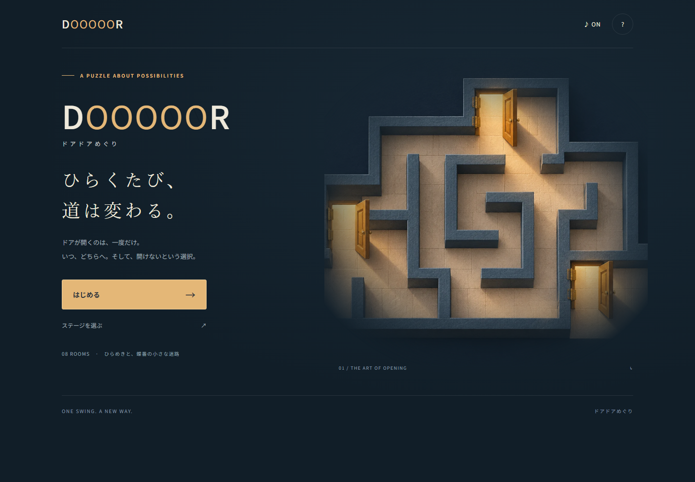

# DOOOOOR / ドアドアめぐり

**ひらくたび、道は変わる。** 一度だけ開くドアで道をつくる、モバイル向けのトップダウンパズル。



ドアは蝶番を中心に90度回転し、開いた先で新しい壁になります。いつ開けるか、どちらから押すか、どの一枚を閉じたまま残すか。鍵・箱・タイマーはありません。

## 起動

Node.js 22.12以降（検証環境は24）、npmが必要です。

```sh
npm install
npm run dev
```

表示されたローカルURLを開きます。リポジトリ取得直後の再現には `npm ci` も使えます。

```sh
npm run build
npm run preview
```

`dist/` が配信用の静的ファイル一式です。相対アセットパスなので、サブディレクトリへ配置できます。外部API、アカウント、サーバー処理、外部フォント、CDNは不要。読み込み後のプレイにネットワークは不要ですが、Service Workerによる再訪時オフライン起動は実装していません。公開先へのデプロイはこのPRに含めません。

スマホ実機を同じLANから試す場合は `npm run dev -- --host 0.0.0.0` を実行し、表示されたLAN URLを使用してください。通常の起動はlocalhostのみです。

## 遊び方

- 人物を緑の出口へ運ぶ。金色の丸が蝶番、点線が開いた後の位置。
- ドアに向かって1歩進むと押して開く。小さな矢印が押せる方向。両側の矢印は両方向ドア。
- 2マス長のドアも一枚の葉。どちらの部分も押せますが、回転する扇形の途中に障害物があれば開きません。
- 開いたドアは固定され、2回目は動かせない。壁や他のドアにぶつかる回転はできない。
- 画面をスワイプ、隣のマスをタップ、方向ボタン、または矢印/WASD。
- **Z / ひと手戻す**：人物と全ドアを正確に1手前へ。**R / やり直す**：その部屋の最初へ。
- 「ヒント」は現在の局面から次の1歩を案内。詰んだときはすぐにUNDOを案内する。
- 音は右上の♪で切り替え。「?」には遊び方と「動きを減らす」。OSの動きを減らす設定も初回に反映。
- クリアした順に次の部屋を解放。進行と設定をlocalStorageに保存する。保存できない環境でも遊べる。

## 収録した8問

| 面 | 名前 | 主題 | 最短手数 | 最小開扉数 |
|---|---|---|---:|---:|
| 001 | OPEN | 押す・90度回転 | 1 | 1 |
| 003 | SWING | 開いた葉を迂回する | 4 | 1 |
| 005 | NOT YET | 正面Aを後から同じ方向に開く | 25 | 4 |
| 009 | COME BACK | 隣の出口へ外周を大回り | 11 | 1 |
| 011 | TWO WAYS | 右押し・左押しを両方体験 | 4 | 2 |
| 012 | CHOOSE | Bの左開きが必須、右開きは罠 | 12 | 3 |
| 018 | HINGE KNOT | A→B→C→Eの四段階の干渉 | 15 | 4 |
| 020 | DOOOOOR | 開く時期 × 開く方向 × 閉じて残す | 18 | 4 |

**20問ではなく、優先8問を完成させています。** 002・004・006–008・010・013–017・019は未収録。005は25手の戻り道を含む難しい面です。ヒントとUNDOで試しながら進めます。全問題で開扉なしの抜け道はなく、012/020は必須の両方向ドアを逆に押せる失敗例も検証しています。

[全問題の標準解・失敗例・制限](docs/validation/LEVELS.md) / [機械可読JSON](docs/validation/levels.json)

## 検証

```sh
npx playwright install chromium webkit
npm run check
```

Linuxではブラウザ準備を `npx playwright install --with-deps chromium webkit` にしてください。

| コマンド | 内容 |
|---|---|
| `npm run lint` | ESLint |
| `npm test` | Nodeの純粋エンジンテスト |
| `npm run validate` | 全状態BFS、最短解再生、最小開扉数、必須方向・順序・後回し・閉じる判断、罠、全状態の不変条件、レポート再生成 |
| `npm run build` | Vite本番ビルド |
| `npm run test:browser` | Chromium PC / 360pxスマホ、WebKit 390pxスマホの実ブラウザ試験・撮影 |

ブラウザ試験は、タイトル→8問全クリア→解放保存→005/012/018/020の罠→UNDOを実際の入力で通します。タップ、スワイプ、モーダル中の入力抑止、減らす動き、音設定、壊れた保存データ、横向き表示も検査します。テスト用ポートは5183。必要に応じて `playwright.config.js` で変更してください。

[検証結果と限界](docs/VALIDATION.md) / [実画面スクリーンショット](docs/screenshots/)

## 構成

- `src/engine.js`：唯一の純粋な遷移エンジン、不変状態の履歴。
- `src/solver.js`：同じ遷移関数を呼ぶBFS、クリア可能集合。
- `src/levels.js`：固定の問題定義と検証条件。
- `scripts/level-metrics.js`：全解とクリア可能な途中状態から、問題の仕掛けの証拠を抽出。
- `src/render.js`：SVG盤面。蝶番から葉を実際に回転させる。
- `src/main.js`：日本語UI、入力、進行、ヒント。
- `src/audio.js` / `storage.js`：ローカル生成音、保存。

ランタイム依存はなく、JavaScript + Vite + SVGを採用しています。この規模のターン制パズルにゲームエンジンや物理ライブラリを持ち込まず、検証対象を小さく保ちました。

[幾何とレベルスキーマ](docs/ENGINE.md) / [旧プロトタイプ監査](docs/AUDIT.md) / [Imagegenプロンプト・素材出所](docs/ART.md)

人間による楽しさの評価、物理端末の入力・音の試聴は未実施です。ブラウザ自動検証の合格と区別しています。
